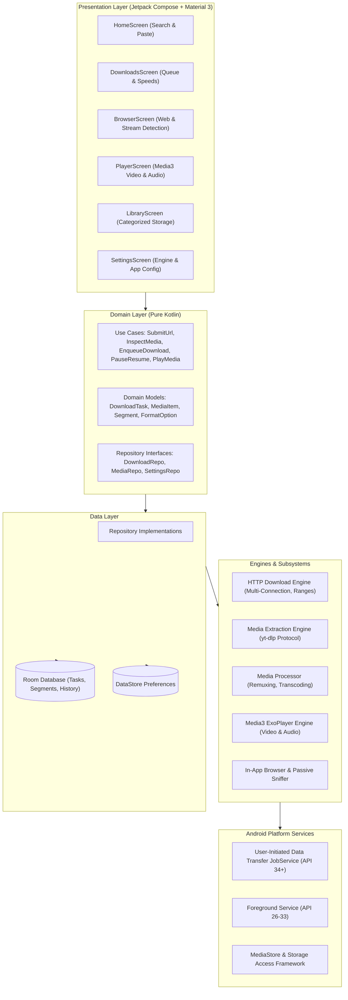
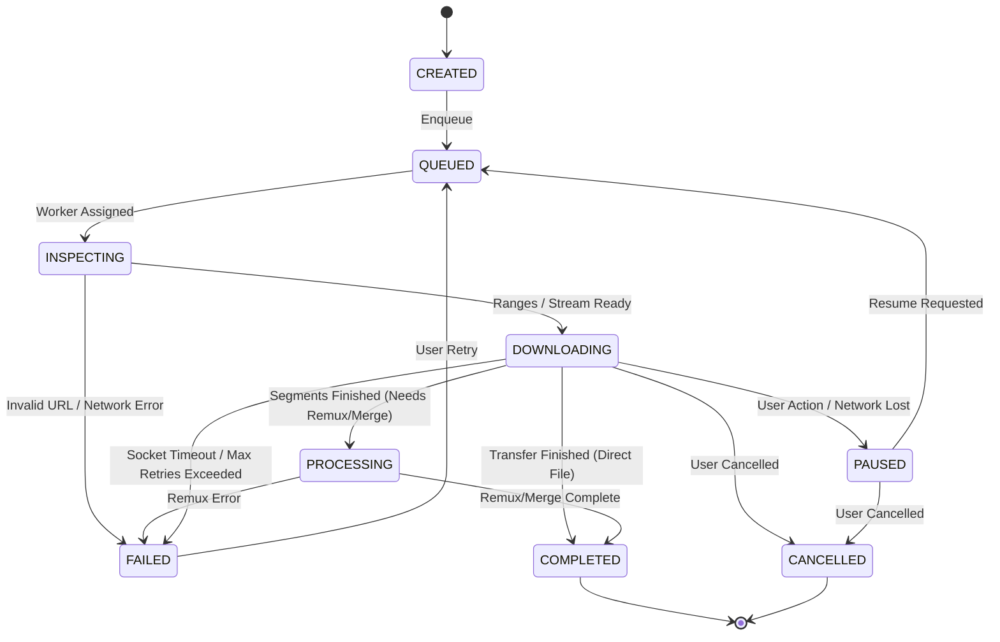

# System Architecture & Technical Specification

## 1. High-Level Architecture Overview

Nuvio follows the **Clean Architecture** paradigm, strictly separating the user interface, domain logic, data persistence, and low-level transfer/processing engines.



---

## 2. Module Responsibilities

| Module | Responsibilities | Dependencies |
|---|---|---|
| `:app` | Application bootstrap, navigation graph, Hilt root component | All features & core modules |
| `:core:common` | Common models, result monad, coroutine dispatchers, loggers | Kotlin coroutines |
| `:core:designsystem` | Material 3 themes, Google color palette, custom composables | Jetpack Compose, Material 3 |
| `:core:database` | Room database definition, entities, DAOs, migrations | Room, SQLite |
| `:core:network` | OkHttp client, headers, redirect handler, SSL pinning config | OkHttp |
| `:core:storage` | File utilities, SAF resolution, path sanitization, free space calculation | Android Storage APIs |
| `:domain` | Business use cases, domain entities, repository contracts | Pure Kotlin |
| `:data` | Repository implementations, database sync, preference adapters | `:domain`, `:core:database`, `:core:network` |
| `:engine:http` | Multi-connection range downloading, segment writer, speed calculator | `:core:network`, `:core:storage` |
| `:engine:ytdlp` | Safe metadata parsing, format selection, extraction runner | `:core:common` |
| `:engine:ffmpeg` | Video/audio stream muxing, audio extraction, format conversion | `:core:common` |
| `:engine:browser` | WebView wrapper, passive media sniffer, URL sanitization | Android WebView |
| `:feature:home` | Search bar, URL paste, format selection bottom sheet | `:domain`, `:core:designsystem` |
| `:feature:downloads` | Active/completed downloads, speed curves, actions (pause/resume) | `:domain`, `:core:designsystem` |
| `:feature:browser` | Tab management, web navigation, media candidate indicator | `:domain`, `:core:designsystem` |
| `:feature:player` | ExoPlayer surface, gesture controls, PiP, playback queue | AndroidX Media3 |
| `:feature:library` | Local file browser, categories, playback triggers, metadata viewer | `:domain`, `:core:designsystem` |
| `:feature:settings` | Download limits, theme selector, component versions | `:domain`, `:core:designsystem` |
| `:service:download` | UIDT JobService, ForegroundService, DownloadExecutionCoordinator | `:engine:http`, `:core:database` |

---

## 3. Download Task State Machine

The download lifecycle is strictly managed by a finite state machine (FSM). State transitions are atomic and persisted in Room to ensure durability across application process restarts or device reboots.



### Valid Transition Matrix

| Current State | Target State | Trigger | Action |
|---|---|---|---|
| `CREATED` | `QUEUED` | Task admitted to queue | Write task to DB |
| `QUEUED` | `INSPECTING` | Concurrency slot available | Send HEAD / probe request |
| `INSPECTING` | `DOWNLOADING` | Range / format verified | Spawn segment workers |
| `INSPECTING` | `FAILED` | Host unreachable / 404 | Record error code |
| `DOWNLOADING` | `PAUSED` | User pause / WiFi lost | Flush byte buffers, cancel jobs |
| `PAUSED` | `QUEUED` | User resume / WiFi restored | Re-verify ETag, re-enqueue |
| `DOWNLOADING` | `PROCESSING` | All byte ranges written | Hand off to FFmpeg for remux |
| `DOWNLOADING` | `COMPLETED` | Final byte written | Atomic file rename, update DB |
| `PROCESSING` | `COMPLETED` | Remux success | Remove intermediate streams |
| `ANY_ACTIVE` | `CANCELLED` | User cancel | Terminate connections, clean `.tmp` |

---

## 4. Multi-Connection Download Architecture

When an HTTP source provides `Accept-Ranges: bytes` and a valid `Content-Length`, the transfer is segmented into `K` disjoint ranges:

```
Total File Size: 100 MB, K = 4 Connections
Segment 0:   0 MB .. 25 MB    (Bytes: 0 - 26,214,399)
Segment 1:  25 MB .. 50 MB    (Bytes: 26,214,400 - 52,428,799)
Segment 2:  50 MB .. 75 MB    (Bytes: 52,428,800 - 78,643,199)
Segment 3:  75 MB .. 100 MB   (Bytes: 78,643,200 - 104,857,599)
```

Each segment writes to a pre-allocated sparse target file using `RandomAccessFile` / `FileChannel` at its designated starting offset plus downloaded bytes. This eliminates memory overhead and avoids expensive concatenations at the end of the transfer.
