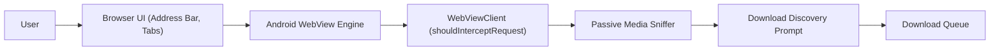

# Built-in Smart Browser & Passive Media Sniffer

## 1. Overview
The in-app browser allows users to browse web pages, discover media, and initiate downloads directly within Nuvio without leaving the app.

---

## 2. Architecture & Components

---

## 3. Passive Media Sniffing Strategy
Instead of injecting aggressive or fragile JavaScript scrapers into third-party sites:
1. `WebViewClient.shouldInterceptRequest(view, request)` passively inspects network request URLs, file extensions, and HTTP response headers.
2. Target MIME signatures:
   - `video/mp4`, `video/webm`, `video/ogg`, `video/quicktime`
   - `audio/mpeg`, `audio/mp4`, `audio/aac`, `audio/ogg`, `audio/flac`
   - `application/x-mpegURL`, `application/vnd.apple.mpegurl` (`.m3u8` playlists)
   - `application/dash+xml` (`.mpd` manifests)
3. When a candidate stream is observed:
   - A subtle floating badge or bottom notification appears on screen: *"Media Stream Detected: [Download]"*.
   - The user decides whether to download or ignore; no automatic downloading is ever forced.

---

## 4. Privacy & Sandbox Hardening
- **File System Isolation:**
  `settings.allowFileAccess = false`  
  `settings.allowContentAccess = false`  
  `settings.allowFileAccessFromFileURLs = false`  
  `settings.allowUniversalAccessFromFileURLs = false`
- **Safe Browsing:** SafeBrowsing enabled where supported on Android 8+.
- **Private Browsing Mode:** In private mode, cookies and local storage are kept entirely in-memory and wiped upon exiting the tab or app.
- **Pluggable Architecture:** A clean `BrowserEngine` interface abstracts the WebView implementation, paving the way for future GeckoView drop-in integration without rewriting UI layers.
