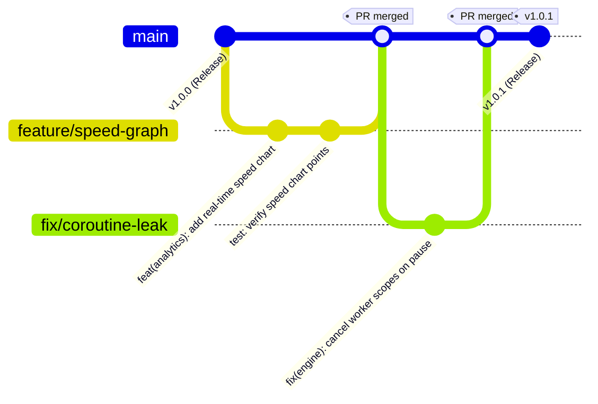

# Nuvio Git Workflow & Contribution Guidelines

This document outlines the Git branching strategy, commit conventions, and hygiene rules enforced across the Nuvio Android project.

---

## 1. Branching Strategy

Nuvio adheres to a trunk-based / simplified GitHub Flow model:



- **`main`**: The primary branch. Always contains stable, buildable, tested code. Direct pushes of experimental or untested code are strictly prohibited.
- **`feature/<name>`**: Feature branches branched from `main`. Used for developing specific modules or capabilities (e.g., `feature/torrent-support`, `feature/pip-mode`).
- **`fix/<name>`**: Bugfix branches branched from `main` to address specific reported issues.
- **`release/<version>`** (optional): Used when staging complex multi-commit release preparations prior to tagging.

---

## 2. Commit Message Conventions

Nuvio follows the **Conventional Commits 1.0.0** specification.

### Structure
```
<type>(<scope>): <short description in present tense>

[optional body explaining 'why', not just 'what']

[optional footer(s), e.g. Closes #12, BREAKING CHANGE]
```

### Allowed Types
| Type | Purpose | Example |
|---|---|---|
| `feat` | New user-facing feature or domain capability | `feat(update): add SHA-256 APK integrity verification` |
| `fix` | Bug fix in existing functionality | `fix(downloader): prevent segment overlap on server 416` |
| `docs` | Documentation only changes | `docs: add release workflow and signing documentation` |
| `test` | Adding or correcting unit/integration tests | `test(json): add JSON parser test for GitHub release response` |
| `ci` | Changes to CI/CD workflows and scripts | `ci: add automated release build and asset upload workflow` |
| `refactor` | Code change that neither fixes a bug nor adds a feature | `refactor(player): simplify surface view lifecycle binding` |
| `perf` | Code change that improves memory or CPU performance | `perf(database): optimize segment query indexing` |
| `chore` | Maintenance tasks, dependency updates, tooling | `chore(gradle): upgrade wrapper to 8.2` |

---

## 3. Pre-Commit Checklist & Hygiene Rules

Before committing any changes to Git:

1. **Working Tree Cleanliness**:
   - Check `git status` to verify only intended files are staged.
   - Run `git diff --staged` to review changes line by line.

2. **Zero Sensitive Data**:
   - **NEVER** commit `.keystore`, `.jks`, passwords, API secrets, or private keys.
   - All `.keystore`, `.jks`, and `signing.properties` files are strictly ignored via `.gitignore`.

3. **Zero Generated Artifacts**:
   - Ensure `build/`, `.gradle/`, and local SDK configuration files (`local.properties`) are never staged.

4. **Local Verification**:
   - Run unit tests before committing:
     ```powershell
     .\gradlew.bat testDebugUnitTest
     ```
   - Verify debug compilation:
     ```powershell
     .\gradlew.bat assembleDebug
     ```

---

## 4. Pull Requests & Code Reviews

- All pull requests targeting `main` must pass the **GitHub Actions CI** suite (`.github/workflows/android-ci.yml`):
  - Unit tests (`testDebugUnitTest`)
  - Lint checks (`lintDebug`)
  - Debug APK compilation (`assembleDebug`)
- PRs must have a descriptive title adhering to conventional commit rules and a markdown summary describing the change and testing performed.
