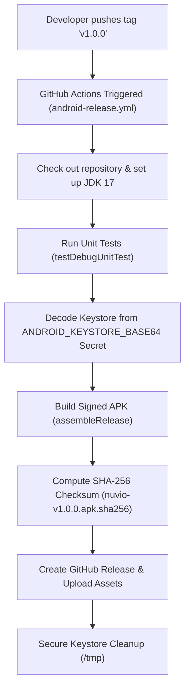

# Nuvio Automated Release Process & CI/CD Pipeline

This guide explains the automated release lifecycle for Nuvio, covering version bumping, Git tagging, GitHub Actions execution, asset publishing, and rollback procedures.

---

## 1. Versioning Standard

Nuvio follows **Semantic Versioning 2.0.0** (`vMAJOR.MINOR.PATCH`):

- **MAJOR**: Breaking changes, massive redesigns, or architectural rewrites.
- **MINOR**: New features, new extraction formats, new engine capabilities (backwards-compatible).
- **PATCH**: Bug fixes, security patches, performance improvements.

### Synchronization Rules
The version must be synchronized in two locations before creating a release:
1. `app/build.gradle.kts`:
   - `versionName = "1.0.0"` (SemVer string)
   - `versionCode = 1` (Monotonically increasing integer; every release **must** increment this)
2. Git tag: `v1.0.0` (must match `v<versionName>`)

---

## 2. Automated Release Workflow

Releases are fully automated via GitHub Actions in `.github/workflows/android-release.yml`.

### Workflow Architecture


### Triggering a Release
To publish a new release:
1. Ensure all unit tests pass locally:
   ```powershell
   .\gradlew.bat testDebugUnitTest
   ```
2. Update `versionCode` and `versionName` in `app/build.gradle.kts` if not already updated.
3. Commit the version bump:
   ```powershell
   git commit -am "chore(release): bump version to 1.0.0"
   ```
4. Create and push the annotated Git tag:
   ```powershell
   git tag -a v1.0.0 -m "Release v1.0.0: Initial release with download engine, player, browser, and updater"
   git push origin v1.0.0
   ```
5. GitHub Actions will detect the `v*` tag, run the release pipeline, compile the signed APK, calculate its SHA-256 checksum, and publish the release.

---

## 3. Release Assets & Artifacts

Every published GitHub release includes:
1. **`nuvio-v<version>.apk`**: The production-ready, signed, zip-aligned Android application package.
2. **`nuvio-v<version>.apk.sha256`**: Cryptographic SHA-256 checksum in standard GNU `sha256sum` format:
   ```
   e3b0c44298fc1c149afbf4c8996fb92427ae41e4649b934ca495991b7852b855  nuvio-v1.0.0.apk
   ```
3. **Automated Changelog**: Generated from commit history since the previous tag.

---

## 4. Manual / Emergency Rollback

If a critical flaw is discovered in a published release:
1. **Mark as Pre-release / Draft**: In GitHub Releases, edit the release and check "Set as a pre-release" so the in-app update checker (which targets `/releases/latest`) skips it.
2. **Publish Immediate Patch**: Increment `versionCode` and `versionName` (e.g., `v1.0.1`), commit the fix, tag, and push. Because Android devices enforce monotonic `versionCode` progression, the new release will immediately be offered to all users.
